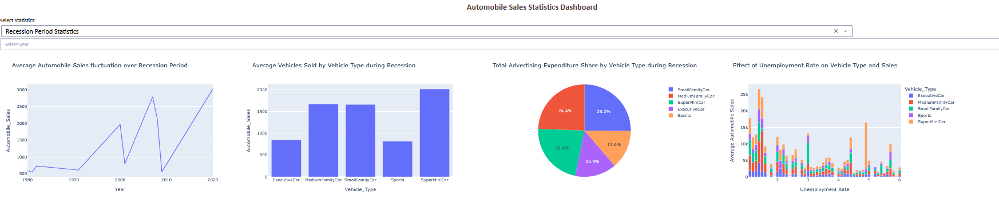
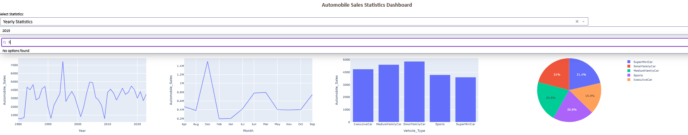

# Automobile Sales Analysis — Recession Impact

## Business problem

As a data analyst at XYZAutomotives, examine 44 years of monthly sales data (1980–2023) to
understand how each U.S. recession affected the business — which vehicle types were hit hardest,
what moved with sales during downturns, and whether the company's advertising spend is allocated
where it's actually needed.

## Two deliverables, one dataset

- **`automobile_sales_analysis.ipynb`** — static exploratory analysis: 9 visualizations (line, bar,
  boxplot-style bar, subplot comparisons, bubble plot, scatter plots, pie charts) walking through
  sales trends, recession vs. non-recession comparisons, and the demand-side factors (consumer
  confidence, price, unemployment) that move with sales during a downturn.
- **`automobile_sales_dashboard.py`** — an interactive Plotly Dash dashboard covering the same
  questions: a toggle between a full Recession-Period view (aggregated across all 6 recessions) and
  a Yearly view (any single year 1980–2023 against the full-period trend).

## Dashboard Preview

**Recession Period Statistics** — aggregated across all 6 recessions since 1980:



**Yearly Statistics** — any single year against the full-period trend (2015 shown):



## Dataset

Monthly automobile sales with price, advertising spend, GDP, unemployment, consumer confidence,
seasonality, and vehicle type, flagged for recession months across the 6 U.S. recessions since 1980
(including COVID-19). Loaded directly from a public CSV URL in both files.

## Errors fixed from the original coursework version

- **Dashboard crash:** selecting "Yearly Statistics" before picking a year passed the dropdown's
  placeholder string into `int()`, crashing the callback. Fixed by checking the selected year is
  actually in the valid year list before using it.
- **Dashboard using stale data:** the "Total Monthly Automobile Sales" chart was grouping by month
  across *all 44 years* instead of the currently selected year, so it never changed no matter which
  year was picked. Fixed to filter to the selected year first.
- **Unused dependency:** removed an unused `more_itertools` import that added a dependency for no
  reason.
- Two visualization tasks in the notebook (advertising spend by vehicle type during recessions, and
  the unemployment-rate line plot) and one written insight were left as unfinished coursework
  placeholders — completed with working code and analysis.
- The optional interactive-map task from the original assignment is intentionally left out, to keep
  this project focused and fully working end to end rather than adding an extra geo-data dependency
  for a "nice to have" extra.

## How to run

**Notebook:** open `automobile_sales_analysis.ipynb` in Colab or Jupyter — every visualization
already has its output baked in except the two that were completed above, which will render the
first time you run the notebook end to end.

**Dashboard:** needs a local Python environment (Colab doesn't run a Dash server well):
```bash
pip install dash pandas plotly
python automobile_sales_dashboard.py
```
Then open the URL it prints (typically `http://127.0.0.1:8050`).

## Tech stack

pandas · Matplotlib · Seaborn · Plotly Express · Dash (callbacks, dropdowns, interactive graphs)
